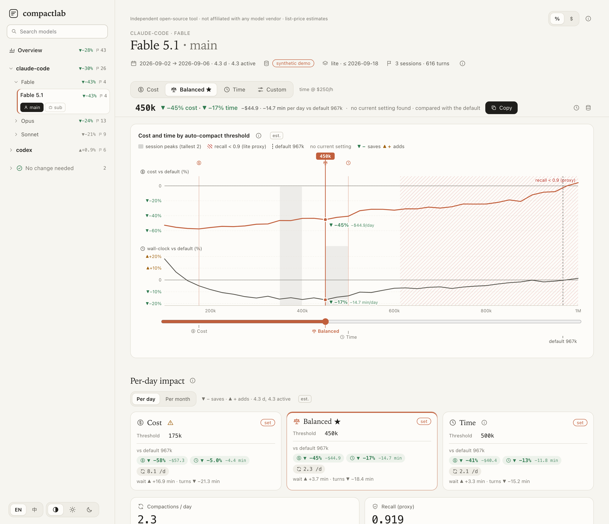
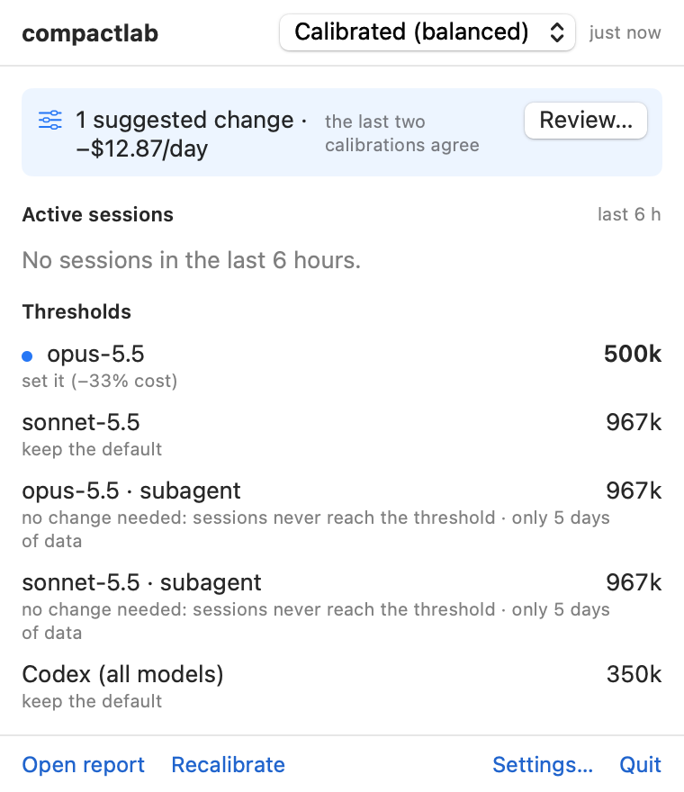
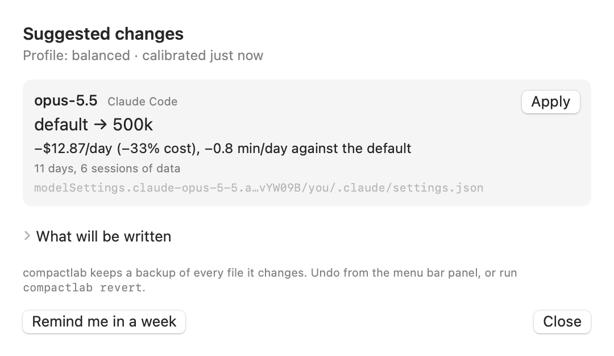
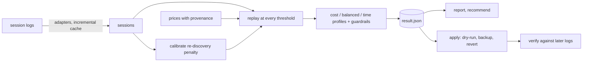

<div align="center">

# compactlab

**Your agent history says where to auto-compact.**

compactlab replays your own Claude Code and Codex session logs at every auto-compact threshold and shows, per model
and role, where cost, waiting and lost context balance out. Then it helps you apply the setting, check it against
your logs, and undo it.

[](https://github.com/LemonCANDY42/compactlab/actions/workflows/ci.yml)
[](https://github.com/LemonCANDY42/compactlab/releases)
[](https://github.com/LemonCANDY42/homebrew-tap)


[](LICENSE)

**English** · [简体中文](README.zh-CN.md)



</div>

## Why

Claude Code and Codex compact a conversation when it reaches a token threshold. Set it too low and you pay for
frequent summaries, cache rewrites and re-reading what the summary dropped. Set it too high and every turn re-reads
a huge, cached-but-not-free prefix, and long contexts get less reliable. The right number depends on how *your*
sessions grow, which models you use and what they cost, so a default or a rule of thumb rarely fits.

- **From your own logs.** It replays the sessions you actually ran, turn by turn, at every threshold. No benchmark
  stand-ins.
- **Per model and per role.** Main agent and subagents grow differently, and so do Opus, Sonnet and GPT sessions.
- **Money and time.** Three profiles (`cost`, `balanced`, `time`) put a price on an hour of waiting, with guardrails
  on how small the window and how long the added waiting may get.
- **Closes the loop.** `apply` writes the setting with a backup, `verify` checks the logs afterwards against what the
  replay predicted, and `revert` undoes it.
- **Local and free by default.** Lite mode reads your logs offline and calls no model. Reports hold token counts and
  model names, never transcript text.



## Does it work?

One real case so far, on the maintainer's machine ([details](docs/RESULTS.md)). Opus 5.5 main sessions in Claude Code,
moved by hand from the default (about 967k) to 650k:

- **Before the change, the replay matched the logged cost within 2%.** That is the control: it shows the replay is
  accurate enough to trust for the rest.
- **Over 25 active days after it, list-price cost per 1k turns fell 21%** (80% interval −24% to −17%; 125 sessions
  before, 86 after).
- **The replay credits the threshold with roughly a third to two thirds of that.** The rest came from Claude Code's
  idle compaction, which reached the machine in the same days; compactlab now tells the two apart.

One machine and one workload, at list prices, is not a benchmark. `compactlab share` writes an anonymous record you
can post to collect more cases ([SHARING.md](docs/SHARING.md)).

## Install

```bash
brew install LemonCANDY42/tap/compactlab
```

Or from PyPI: `uv tool install compactlab` or `pipx install compactlab`.
Python 3.11+, no runtime dependencies. Tested on macOS; Linux runs in CI.

To try it without installing anything (bundled synthetic sessions, no history or API key needed):

```bash
uvx compactlab demo
```

## Quickstart

```bash
compactlab doctor                     # which harnesses, logs and settings it finds
compactlab report --open              # analyze the last 30 days -> offline HTML report
compactlab recommend --copy           # the setting to paste, for each harness (prints or copies; never writes)

compactlab simulate --out result.json # the same analysis, saved for apply
compactlab apply --result result.json --claude-settings ~/.claude/settings.json   # dry-run diff
compactlab verify                     # days later: did the change do what the replay predicted?
compactlab revert                     # undo the last apply
```

For each model and role you get three profiles next to the harness default and your current setting, with the change
in cost, wall-clock and compactions per day. When the default already works, it says **no action needed**, **keep
current** or **keep default** instead of inventing a change.

| Profile | Value of an hour of waiting | Guardrails |
| --- | --- | --- |
| `cost` | $10 | warns below 25% of the window or above 30 min/day of added waiting |
| `balanced` (default) | $250 | never below 40% of the window; at most 30 min/day of added waiting |
| `time` | $600 | never below 50% of the window; at most 30 min/day of added waiting |

How to read the output, every setting key it can emit, `verify` in detail and the per-harness notes:
[**User guide**](docs/GUIDE.md).

## Ways to use it

| | What it is | More |
| --- | --- | --- |
| **CLI and report** | `simulate`, `report`, `recommend`, `apply`, `verify`. The report is one offline HTML file, English or Chinese, light or dark. | [User guide](docs/GUIDE.md) |
| **`compactlab top`** | An htop-like terminal view of the latest result: models on the left, cost and time curves on the right. | [TUI.md](docs/TUI.md) |
| **Menu bar app** (macOS, preview) | Every active session's context against its threshold, whether its prompt cache is still warm, a daily calibration, and review → apply → verify → undo. English and Chinese. | [app/](app/README.md) |
| **Background service** | `compactlab serve` recalibrates on a schedule with a localhost report and JSON API; opt-in auto-apply within strict limits. | [SERVICE.md](docs/SERVICE.md) |
| **In-session lens** | A Claude Code mod that adds one row above the prompt: this session's context against the default and the compactlab threshold. | [MOD.md](docs/MOD.md) |
| **Engine API** | `compactlab engine`: versioned JSON on stdout for apps and scripts, no port. | [ENGINE_API.md](docs/ENGINE_API.md) |

<p align="center">
  
  
</p>

The menu bar app (macOS 14+) is signed and notarized; the Homebrew cask installs this CLI with it:

```bash
brew install --cask LemonCANDY42/tap/compactlab-app
```

Or download the disk image from [Releases](https://github.com/LemonCANDY42/compactlab/releases) and install the CLI
first. The lens mod installs with
`/plugin install compactlab-lens --marketplace LemonCANDY42/compactlab`; it is an independent project, not
affiliated with Anthropic.

## Supported harnesses

| Harness | Reads | Settings | Status |
| --- | --- | --- | --- |
| Claude Code | `~/.claude/projects/**/*.jsonl`, subagents included | `recommend` and `apply`: `modelSettings.<model>.autoCompactWindow` | supported |
| Codex | `~/.codex/sessions/**/rollout-*.jsonl` | `recommend` and `apply`: `model_auto_compact_token_limit` (one global value) | supported |
| OpenCode 1.x | `~/.local/share/opencode/opencode.db` (read-only) | `recommend`: a per-model `limit` | supported |
| DeepSeek Harness (dsh) | `~/.dsh/sessions/**` | `recommend`: a `modelPolicies` entry | experimental, not yet run on real history |
| Gemini CLI | `~/.gemini/tmp/<project>/chats/*.jsonl` | `recommend`: `model.compressionThreshold` | experimental, not yet run on real history |

Hermes, Qwen Code, Kimi CLI and Goose are on the [roadmap](docs/ROADMAP.md); the
[adapter guide](docs/ADDING_A_HARNESS.md) shows how to add one.

## How it works



Each session becomes the tokens added per turn, and compactlab replays that growth at each threshold. It charges cache
reads, cache writes (at the cache tier the logs show), output, a summarizer call per compaction, and the re-reads and
corrections that tend to follow one, and adds up wall-clock time from latency curves fitted to your own timestamps.
Formulas and what is measured versus assumed: [METHODOLOGY.md](docs/METHODOLOGY.md). Background:
[WHY_THRESHOLDS.md](docs/WHY_THRESHOLDS.md).

## Privacy and safety

- **Offline by default.** Lite mode makes no network and no model calls. Only `pricing refresh` (or the opt-in
  `pricing auto`) downloads public price files, and only deep mode calls a model, after showing an estimate and
  asking for `--yes` and a `--budget`.
- **No transcript text leaves your logs.** Reports and `result.json` hold token counts, model names and session ids;
  `report --redact` hashes the ids. The scan cache keeps token counts and times, not prompts, tool arguments or
  output (one exception: a last message still waiting for its reply).
- **Writes are opt-in and reversible.** `apply` is a dry-run diff; writing needs `--write` plus a
  [pre-authorization](docs/SAFETY.md) or `--i-authorize`, backs up every file, and `revert` restores only the keys it
  changed.
- **Sharing is a file you post yourself.** `compactlab share` writes numbers and model names only and sends nothing.

Threat model and reporting: [SECURITY.md](SECURITY.md).

## Limitations

- Lite-mode recall is an **assumed** curve, not a measurement; deep mode measures it on samples.
- Costs are list-price estimates for comparing thresholds, not your invoice (subscriptions, discounts and credits are
  ignored). Wall-clock comes from log timestamps and is flagged when data is thin.
- The one real-world check is a single machine (above). More cases are needed before the savings can be generalized.
- Windows is untested.

Full list: [User guide § Limitations](docs/GUIDE.md#limitations).

## Documentation

- [User guide](docs/GUIDE.md): reading the output, setting keys, apply and verify, harness notes
- [Results on real logs](docs/RESULTS.md) · [Methodology](docs/METHODOLOGY.md) · [Why thresholds matter](docs/WHY_THRESHOLDS.md)
- [Safety: apply and revert](docs/SAFETY.md) · [Running as a service](docs/SERVICE.md) · [Sharing results](docs/SHARING.md)
- [Terminal views](docs/TUI.md) · [HTML report design](docs/REPORT_UI.md) · [Lens mod](docs/MOD.md) · [Menu bar app](app/README.md)
- For contributors: [Architecture](docs/ARCHITECTURE.md) · [Engine API](docs/ENGINE_API.md) · [Adding a harness](docs/ADDING_A_HARNESS.md) · [Roadmap](docs/ROADMAP.md)

All docs are indexed in [docs/README.md](docs/README.md).

## Related work

[ccusage](https://github.com/ryoppippi/ccusage) and [CodexBar](https://github.com/steipete/CodexBar) track token
usage and cost from the same logs; compactlab borrows parsing ideas from them, not code. Chroma's
[Context Rot](https://trychroma.com/research/context-rot) report covers long-context degradation, and LangWatch's
[study on optimal context windows](https://langwatch.ai/research/finding-the-optimal-context-window) looks at the
same trade-off on its own agents.

## Contributing

Adapters, pricing updates and new fact-check heuristics are welcome; tests use synthetic data only. See
[CONTRIBUTING.md](CONTRIBUTING.md).

## License

[MIT](LICENSE)
