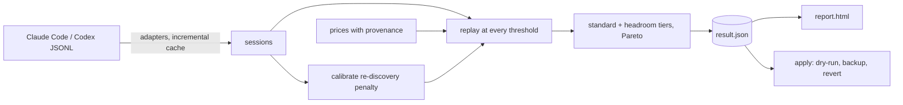

<div align="center">

# compactlab

**Your agent history says where to auto-compact.**<br>
Measure cost vs. context-rot trade-offs per model and per role, then tune auto-compact safely.

[](https://github.com/OWNER/compactlab/actions/workflows/ci.yml)
[](LICENSE)


```bash
uvx compactlab demo
```

<sub>Builds a report from bundled synthetic sessions and opens it. No history, network or API key needed.</sub>

</div>

---

Claude Code and Codex compact a conversation when it reaches a token threshold. Set it too low and you pay for
frequent summaries, cache rewrites and re-reading what the summary dropped. Set it too high and every turn re-reads
a huge, cached-but-not-free prefix, and long contexts get less reliable. The right number depends on how *your*
sessions grow, your models and their prices. compactlab replays your own session logs at every threshold and tells
you where the trade-off sits, per model and per role (main agent vs subagent).


## Quickstart

```bash
uvx compactlab demo                       # synthetic data -> report (zero config)
uvx compactlab doctor                     # where are my logs and configs?
uvx compactlab report --open              # lite analysis of your last 30 days -> HTML report
uvx compactlab simulate --out result.json # same analysis, saved for apply
uvx compactlab apply --result result.json --claude-settings ~/.claude/settings.json   # dry-run diff
```

`pipx install compactlab` or `pip install compactlab` work too. Python 3.11+, no runtime dependencies.

## What you get

For each model and role, two results:

- **standard**: the threshold with the lowest replayed cost + re-discovery penalty that meets a recall floor.
- **headroom** (default): the largest threshold within 12% of that optimum. You pay a little more and get fewer
  lossy compactions. The tolerance is a flag (`--headroom`), and the extra cost and the drop in compactions are
  printed.

Sample output (**synthetic demo data**, not a benchmark):

```
model                  role     sess  turns  standard  headroom   +cost  -compact  recall
claude-opus-5-5        main        6   1464      175k      300k    9.4%        40   0.925
claude-opus-5-5        subagent    3    134      200k      350k    4.1%         3   0.948
claude-sonnet-5-5      main        6   1137      175k      250k    9.4%        24   0.923
claude-sonnet-5-5      subagent    3    137      225k      375k   11.8%         1   0.945
gpt-5-codex            main        6    737      175k      250k    9.2%        12   0.929
```

The HTML report is one offline file. It has gear switching (Eco / Standard / Headroom / Recall / Custom), estimated
spend against a replay of your own history, a Pareto frontier, cost curves, where your tokens sit by context size,
and any session's real context curve next to the same session replayed at the chosen threshold.

## Two modes

| | `lite` (default) | `deep` (opt-in) |
| --- | --- | --- |
| Inputs | your logs + price table | lite + a model you choose, via Claude Code or Codex |
| Does | replay simulation, cost model, re-discovery penalty, summary fact-check heuristics | re-summarizes sampled sessions at candidate thresholds, probes them for ground-truth facts, LLM judge on a different model |
| Recall | assumed proxy | measured on samples; disagreements with lite are shown |
| Cost | $0, offline | shows an estimate first, needs `--yes`, stops at `--budget` |

```bash
compactlab simulate --mode deep --executor claude-code --model claude-sonnet-5-5 \
  --judge-model claude-haiku-5-5 --budget 3            # prints the estimate; add --yes to run
```

If measured recall at the headroom threshold falls below the floor, deep lowers headroom and says so.

## How it works



Each session becomes the tokens added per turn. compactlab replays that growth for each threshold. It charges
cache reads, cache writes (after a compaction, or after an idle gap longer than the cache TTL), output, a summarizer
call per compaction, and the re-reads and corrections that tend to follow one. Details and formulas:
[docs/METHODOLOGY.md](docs/METHODOLOGY.md). Background: [docs/WHY_THRESHOLDS.md](docs/WHY_THRESHOLDS.md).

## Supported harnesses

| Harness | Logs | Setting `apply` writes | Status |
| --- | --- | --- | --- |
| Claude Code | `~/.claude/projects/**/*.jsonl` (incl. `subagents/`, `$CLAUDE_CONFIG_DIR`) | `modelSettings.<model>.autoCompactWindow` (per model) | supported |
| Codex | `~/.codex/sessions/**/rollout-*.jsonl` (`$CODEX_HOME`) | top-level `model_auto_compact_token_limit` (global only) | supported |
| dsh, opencode, pi | | | planned: one `Adapter` + fixtures ([guide](docs/ADDING_A_HARNESS.md)) |

Neither harness lets subagents have their own threshold, so `apply` writes the main-role value.

## Safety and privacy

- **Offline by default.** Lite mode makes no network and no model calls. Only `pricing refresh` fetches public
  prices, and only deep mode calls a model, and only after you confirm.
- **Nothing leaves your machine in lite mode.** Reports and `result.json` hold token counts, model names and
  session ids, never transcript text or file paths. `report --redact` hashes the ids.
- **Config changes are opt-in and reversible.** `apply` is a dry-run diff. Writing needs `--write` plus a
  [pre-authorization file](docs/SAFETY.md) (allowed files, keys, models, value bounds, expiry) or `--i-authorize`.
  Every write is backed up, and `revert` restores only the keys it changed.
- The scan cache (`~/.compactlab/cache`, mode 0600) stores short excerpts. Use `--no-cache` or `compactlab cache clear`.

## Limitations

- Lite-mode recall is an **assumed** curve, not a measurement of any model. Deep mode measures recall on samples
  of compactlab's excerpts, not the full transcript the harness would summarize.
- Replayed cost is for comparing thresholds, not a reconstruction of your invoice.
- The bundled prices are a dated public snapshot (models.dev). `compactlab pricing show` lists the source of every
  row; refresh or override them as needed.
- Some log-format details (Codex fork replay, compaction events) are marked `assumed` in
  [`data/harness_formats.json`](src/compactlab/data/harness_formats.json) until checked against more real files.
- Tested on macOS; Linux paths follow the same defaults and run in CI. Windows is untested.

## FAQ

**Will it change my settings?** Not unless you pass `--write` with an authorization, and even then only the
allow-listed key, with a backup.

**Why not just use the lowest-cost threshold?** Cost alone favors compacting early. Every compaction loses detail,
so the default leaves headroom. Use `--tier standard` if you want the optimum.

**Does it work without any history?** `compactlab demo` uses bundled synthetic sessions.

**Can I trust the recall numbers?** In lite mode, no. Treat them as a guard-rail you can configure. Deep mode
gives sampled measurements with their own noise.

## Related work

[ccusage](https://github.com/ryoppippi/ccusage) and [CodexBar](https://github.com/steipete/CodexBar) track token
usage and cost from the same logs. compactlab borrows parsing ideas from them, not code. Chroma's
[Context Rot](https://trychroma.com/research/context-rot) report covers long-context degradation, and LangWatch's
[study on optimal context windows](https://langwatch.ai/research/finding-the-optimal-context-window) looks at the
same trade-off on its own agents.

## Contributing

Adapters, pricing updates and new fact-check heuristics are welcome. See [CONTRIBUTING.md](CONTRIBUTING.md) and
[docs/ADDING_A_HARNESS.md](docs/ADDING_A_HARNESS.md). Tests use synthetic data only. Run
`python scripts/secrets_scan.py --all` before pushing.

## License

[MIT](LICENSE). [中文说明](README.zh-CN.md)
