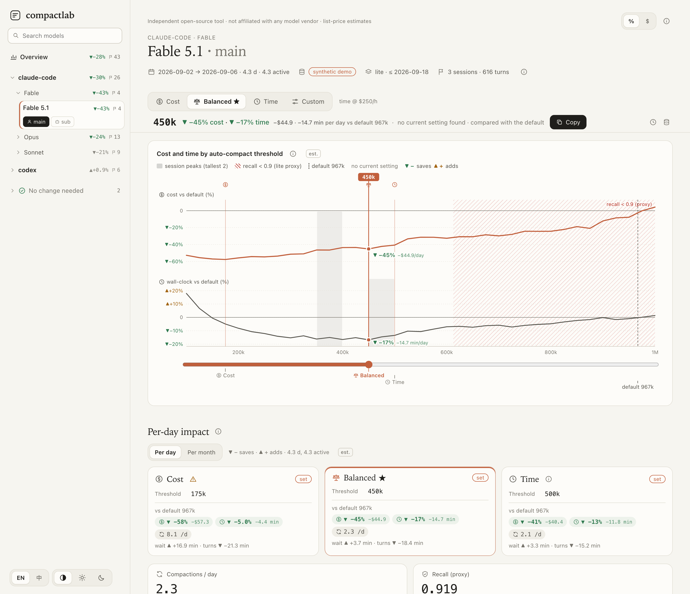
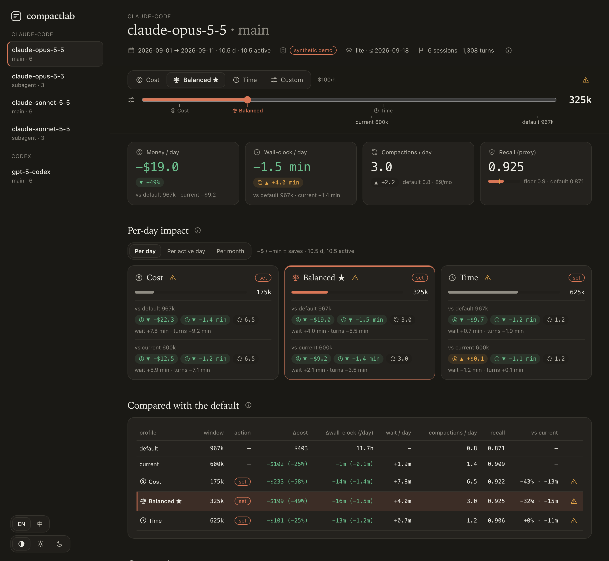
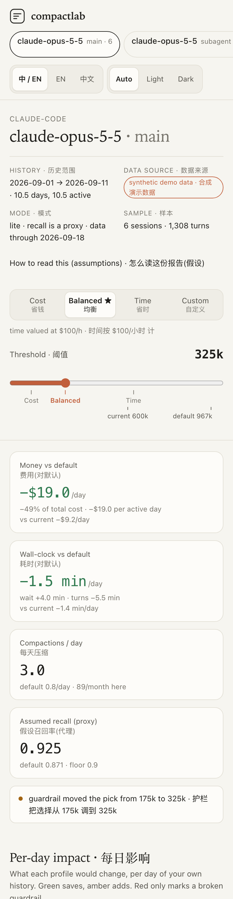
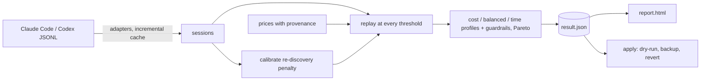

<div align="center">

# compactlab

**Your agent history says where to auto-compact.**<br>
Measure cost vs. context-rot trade-offs per model and per role, then tune auto-compact safely.

[](https://github.com/OWNER/compactlab/actions/workflows/ci.yml)
[](LICENSE)




```bash
uvx compactlab demo
```

<sub>Builds a report from bundled synthetic sessions and opens it. No history, network or API key needed.</sub>

</div>

---

Claude Code and Codex compact a conversation when it reaches a token threshold. Set it too low and you pay for
frequent summaries, cache rewrites and re-reading what the summary dropped. Set it too high and every turn re-reads
a huge, cached-but-not-free prefix, and long contexts get less reliable. The right number depends on how *your*
sessions grow, your models and their prices. compactlab replays your own session logs at every threshold and tells
you where the trade-off sits, per model and per role (main agent vs subagent).



## Quickstart

```bash
uvx compactlab demo                       # synthetic data -> report (zero config)
uvx compactlab doctor                     # where are my logs and configs?
uvx compactlab report --open              # lite analysis of your last 30 days -> HTML report
uvx compactlab simulate --out result.json # same analysis, saved for apply
uvx compactlab apply --result result.json --claude-settings ~/.claude/settings.json   # dry-run diff
```

`pipx install compactlab` or `pip install compactlab` work too. Python 3.11+, no runtime dependencies.

## What you get

For each model and role, three **profiles**, side by side, each compared with **the harness default** (what happens
if you change nothing) and with **your current setting** when compactlab can read it. A profile is the price you put
on an hour of agent wall-clock, plus guardrails:

| Profile | Value of time | Guardrails |
| --- | --- | --- |
| `cost` | $10/h (money first) | none on window size; warns below 25% of the max window and when compaction wait grows by more than 30 min/day |
| `balanced` (default) | $100/h | never below 25% of the max window; at most 30 min/day of added compaction wait |
| `time` | $400/h (time first) | never below 35% of the max window; at most 30 min/day of added compaction wait |

Within its guardrails, each profile picks the largest threshold whose score (list-price replay cost + re-discovery
penalty + value of time × wall-clock) is within 2% of its lowest, with assumed recall at or above a floor (0.90).
`--profile` chooses which one `apply`, `recommend` and the report lead with; `--value-of-time` overrides that
profile's price of time. Both work on a saved result without re-running. **no action needed** is shown instead of a
number when the default never compacts in those sessions, and **keep default** when a profile would not beat it.

Every profile reports Δcost, Δwall-clock in hours and minutes per day (time saved by smaller contexts minus time
added by compactions and re-discovery, fitted from your own timestamps), compactions per day and recall against the
default and your current setting. Costs are list-price estimates (no discounts, plans or credits). Recall in lite mode
is an assumed proxy, not a measurement. When a group has too few timed compactions (fewer than 20) its latency fit is
not used: it borrows the pooled fit of all sessions of that harness, or a deliberately pessimistic prior, and says so.

Sample output (**synthetic demo data**, not a benchmark; output is bilingual by default, `--lang en` shown; `*` marks
the selected profile):

```
claude-opus-5-5 · main · 6 sessions · 1308 turns · 10 days · window 1000k
  profile            window action                   Δcost vs default     Δtime (/day)  compactions/d           recall
  default              967k -                             $403 (base)                0            0.8            0.871
  current              600k -                            -$102 (-25%)        -1m (-0m)            1.4            0.909
  balanced*            325k set                          -$199 (-49%)      -0.3h (-2m)            3.0   0.925 (+0.054)
  cost                 175k set                          -$233 (-58%)      -0.2h (-1m)            6.5   0.922 (+0.051)
  time                 625k set                          -$101 (-25%)      -0.2h (-1m)            1.2   0.906 (+0.034)
  · vs current: cost -$131 (-43%) -0.2h; balanced -$96 (-32%) -0.2h; time +$1 (+0%) -0.2h
  · time model: turn latency from this group's data, compaction latency from this group's data (22 own samples)
  · balanced: guardrail moved the pick from 175k to 325k
  · cost: below 25% of the max window; expect frequent lossy compactions
  · time: guardrail moved the pick from 325k to 625k

claude-opus-5-5 · subagent · 3 sessions · 143 turns · 4 days · window 1000k
  profile            window action                   Δcost vs default     Δtime (/day)  compactions/d           recall
  default              967k -                              $18 (base)                0            0.0            0.937
  current              600k -                               +$0 (+0%)        +0m (+0m)            0.0            0.937
  balanced*               - no action needed                        -                -            0.0            0.937
  cost                    - no action needed                        -                -            0.0            0.937
  time                    - no action needed                        -                -            0.0            0.937
  · no action needed: the default never compacts in these sessions

gpt-5-codex · main · 6 sessions · 871 turns · 5 days · window 400k
  profile            window action                   Δcost vs default     Δtime (/day)  compactions/d           recall
  default              360k -                              $43 (base)                0            3.1            0.929
  balanced*            350k keep default                    +$0 (+1%)        +4m (+1m)            3.3   0.929 (-0.000)
  cost                 325k set                             -$2 (-4%)      +0.1h (+1m)            3.5   0.930 (+0.001)
  time                 350k keep default                    +$0 (+1%)        +4m (+1m)            3.3   0.929 (-0.000)
```

The HTML report is one offline file (no fonts, scripts or images fetched), in English or Chinese (follows the
browser language; one toggle switches), light or dark (follows the system, or pick one). It leans on icons, delta
chips (▼ green saves, ▲ amber adds) and small gauges rather than prose; explanations sit behind ⓘ tooltips and
warnings are ⚠ icons with a tooltip. A sidebar lists each harness / model / role group (a top bar on phones); the
header states the history's date range, data source and mode. A sticky control bar holds the profile switch and a
threshold slider with marks for each profile, the default and your current setting. Below it: KPI cards for the
slider position, the per-day impact of every profile, a comparison table, a Pareto frontier and cost and wall-clock
curves with hover/tap tooltips and direct labels, where your tokens sit by context size, and any session's real
context curve next to the same session replayed at the chosen threshold. Thin data, short histories and borrowed
time models are called out in plain language.

| Light | Dark | Phone |
| --- | --- | --- |
|  |  |  |

### Per-day impact

For each profile of each group, versus the harness default and versus your current setting: money saved or added
(USD), wall-clock saved or added (minutes, with compaction wait and the turn-speed gain from a smaller context shown
separately), and compactions, each per calendar day, per active day and per month (30 days). The calendar span is
the history window actually covered; an active day is a local date with at least one turn. Dividing by calendar days
understates a heavy user's day, so both are shown. **Sign: `-$204.8/day` means it saves $204.8 a day**; `+` adds.
The report colours savings green and added cost or time amber, and keeps red for broken guardrails. Money is a
list-price estimate and recall is a lite-mode proxy. `compactlab recommend` prints the same table after the
snippets (`--json` adds it under `impact`):

```
Per-day impact · claude-opus-5-5 · main · history 10.5 calendar days, 10.5 active days (with ≥1 turn)
  vs harness default 967k
    profile         window      $/day  $/active d     $/month   min/day     wait    turns  min/active d   h/month  compact/d  /month
    balanced*         325k     -$19.0      -$19.0     -$569.2      -1.5     +4.0     -5.5          -1.5      -0.8        3.0      89
    cost              175k     -$22.3      -$22.3     -$668.0      -1.4     +7.8     -9.2          -1.4      -0.7        6.5     195
    time              625k      -$9.7       -$9.7     -$291.0      -1.2     +0.7     -1.9          -1.2      -0.6        1.2      37
  vs your current 600k
    profile         window      $/day  $/active d     $/month   min/day     wait    turns  min/active d   h/month  compact/d  /month
    balanced*         325k      -$9.2       -$9.2     -$276.2      -1.4     +2.1     -3.5          -1.4      -0.7        3.0      89
    cost              175k     -$12.5      -$12.5     -$375.0      -1.2     +5.9     -7.1          -1.2      -0.6        6.5     195
    time              625k      +$0.1       +$0.1       +$2.0      -1.1     -1.2     +0.1          -1.1      -0.5        1.2      37
```

(Synthetic demo data, `--lang en`. The demo spreads sessions over every day, so active days equal calendar days.)

## Copy the settings

```bash
compactlab recommend                                  # Claude Code settings.json fragment + Codex config.toml line
compactlab recommend --scope project --copy           # project-level, onto the clipboard (macOS)
compactlab recommend --scope agent                    # subagent frontmatter (autoCompactWindow)
compactlab recommend --format env                     # CLAUDE_CODE_AUTO_COMPACT_WINDOW instead
compactlab recommend --check                          # are the keys still verified against the docs?
```

Each snippet names its target file and carries a merge one-liner that leaves other keys alone, the evidence it came
from (groups, delta vs default, time per day, where the time model came from) and a revert hint. `--profile` picks the
profile (default balanced); `--all-profiles` prints all three. Values never exceed the model's window or your
caps, and groups that need no change are listed as omitted. `recommend` only prints or copies; `apply` is still the
only command that writes, under pre-authorization. The report has the same panel with copy buttons.

| Harness | Scope | Key | Status |
| --- | --- | --- | --- |
| Claude Code | global / project | `modelSettings.<model>.autoCompactWindow` (v2.1.288+) | documented |
| Claude Code | agent | subagent frontmatter `autoCompactWindow` (v2.1.296+, lowers only) | documented |
| Claude Code | session | `CLAUDE_CODE_AUTO_COMPACT_WINDOW` env (wins over all), `--autocompact` flag | documented |
| Codex | global / project | top-level `model_auto_compact_token_limit` (project needs trust) | documented |
| Codex | session | `codex -c model_auto_compact_token_limit=N` | documented |
| Codex | agent / profile | role `config_file` layer, profile file | **unverified**: emitted with a warning |
| Codex | env var | none documented | not emitted |

Facts, sources and verified-on dates live in [`data/config_knobs.json`](src/compactlab/data/config_knobs.json).

## In-session lens (Claude Code mod)

`mods/compactlab-lens` is an optional Claude Code mod. It adds one row above the prompt, and a pane on desktop, with
this session's context against the default and the compactlab threshold, the per-day savings `simulate` estimated,
and a ⚠ when the window in force differs. It reads only `~/.compactlab/lens.json`, which `simulate` writes. It never
writes settings, calls a model or uses the network. Its "copy" button puts `/autocompact <n>` on your clipboard.

```
▸ ●●●●●●●●●●·┃··········┊· 412k ┊967k ┃500k ▼−$204.8/day ▲+4.8m/day ⟳0 ⚠
```

```
/plugin install compactlab-lens --marketplace <owner>/compactlab
```

See [docs/MOD.md](docs/MOD.md). The mod is an independent open-source project, not affiliated with Anthropic.

## Two modes

| | `lite` (default) | `deep` (opt-in) |
| --- | --- | --- |
| Inputs | your logs + price table | lite + a model you choose, via Claude Code or Codex |
| Does | replay simulation, cost model, re-discovery penalty, summary fact-check heuristics | re-summarizes sampled sessions at candidate thresholds, probes them for ground-truth facts, LLM judge on a different model |
| Recall | assumed proxy | measured on samples; disagreements with lite are shown |
| Cost | $0, offline | shows an estimate first, needs `--yes`, stops at `--budget` |

```bash
compactlab simulate --mode deep --executor claude-code --model claude-sonnet-5-5 \
  --judge-model claude-haiku-5-5 --budget 3            # prints the estimate; add --yes to run
```

If measured recall at a profile's threshold falls below the floor, deep lowers that profile and says so.

## How it works



Each session becomes the tokens added per turn. compactlab replays that growth for each threshold. It charges
cache reads, cache writes (after a compaction, or after an idle gap longer than the cache TTL), output, a summarizer
call per compaction, and the re-reads and corrections that tend to follow one. It also adds up wall-clock time
from latency curves fitted to your own timestamps. Details and formulas:
[docs/METHODOLOGY.md](docs/METHODOLOGY.md). Background: [docs/WHY_THRESHOLDS.md](docs/WHY_THRESHOLDS.md).

## Supported harnesses

| Harness | Logs | Setting `apply` writes | Status |
| --- | --- | --- | --- |
| Claude Code | `~/.claude/projects/**/*.jsonl` (incl. `subagents/`, `$CLAUDE_CONFIG_DIR`) | `modelSettings.<model>.autoCompactWindow` (per model) | supported |
| Codex | `~/.codex/sessions/**/rollout-*.jsonl` (`$CODEX_HOME`) | top-level `model_auto_compact_token_limit` (global only) | supported |
| dsh, opencode, pi | | | planned: one `Adapter` + fixtures ([guide](docs/ADDING_A_HARNESS.md)) |

Neither harness lets subagents have their own threshold, so `apply` writes the main-role value.

## Safety and privacy

- **Offline by default.** Lite mode makes no network and no model calls. Only `pricing refresh` fetches public
  prices, and only deep mode calls a model, and only after you confirm.
- **Nothing leaves your machine in lite mode.** Reports and `result.json` hold token counts, model names and
  session ids, never transcript text or file paths. `report --redact` hashes the ids.
- **Config changes are opt-in and reversible.** `apply` is a dry-run diff. Writing needs `--write` plus a
  [pre-authorization file](docs/SAFETY.md) (allowed files, keys, models, value bounds, expiry) or `--i-authorize`.
  Every write is backed up, and `revert` restores only the keys it changed.
- The scan cache (`~/.compactlab/cache`, mode 0600) stores short excerpts. Use `--no-cache` or `compactlab cache clear`.

## Limitations

- Lite-mode recall is an **assumed** curve, not a measurement of any model. Deep mode measures recall on samples
  of compactlab's excerpts, not the full transcript the harness would summarize.
- Replayed cost is a list-price estimate for comparing thresholds, not a reconstruction of your invoice
  (subscriptions, discounts and credits are ignored). Wall-clock estimates come from
  log timestamps (response time minus the preceding input), a proxy that is flagged when data is thin.
- The bundled prices are a dated public snapshot (models.dev). `compactlab pricing show` lists the source of every
  row; refresh or override them as needed.
- Some log-format details (Codex fork replay, compaction events) are marked `assumed` in
  [`data/harness_formats.json`](src/compactlab/data/harness_formats.json) until checked against more real files.
- Tested on macOS; Linux paths follow the same defaults and run in CI. Windows is untested.

## FAQ

**Will it change my settings?** Not unless you pass `--write` with an authorization, and even then only the
allow-listed key, with a backup.

**Why not just use the lowest-cost threshold?** Cost alone favors compacting early, and every compaction costs
minutes of waiting and some lost detail. On real histories a cost-first pick can mean several times more compactions
than the default. The default `balanced` profile prices your time at $100/h and never goes below a quarter of the
window; `--profile cost` is there if money is what you want to minimize.

**Does it work without any history?** `compactlab demo` uses bundled synthetic sessions.

**What is the baseline?** The harness default from its docs or source: about 967K tokens for Claude models with a
native 1M window, 200K for Sonnet/Opus 4.6 without extended context, the context limit otherwise; 90% of the
context window for Codex. Sources are in [`data/harness_defaults.json`](src/compactlab/data/harness_defaults.json).

**Can I trust the recall numbers?** In lite mode, no. Treat them as a guard-rail you can configure. Deep mode
gives sampled measurements with their own noise.

## Related work

[ccusage](https://github.com/ryoppippi/ccusage) and [CodexBar](https://github.com/steipete/CodexBar) track token
usage and cost from the same logs. compactlab borrows parsing ideas from them, not code. Chroma's
[Context Rot](https://trychroma.com/research/context-rot) report covers long-context degradation, and LangWatch's
[study on optimal context windows](https://langwatch.ai/research/finding-the-optimal-context-window) looks at the
same trade-off on its own agents.

## Contributing

Adapters, pricing updates and new fact-check heuristics are welcome. See [CONTRIBUTING.md](CONTRIBUTING.md) and
[docs/ADDING_A_HARNESS.md](docs/ADDING_A_HARNESS.md). Tests use synthetic data only. Run
`python scripts/secrets_scan.py --all` before pushing.

## License

[MIT](LICENSE). [中文说明](README.zh-CN.md)
