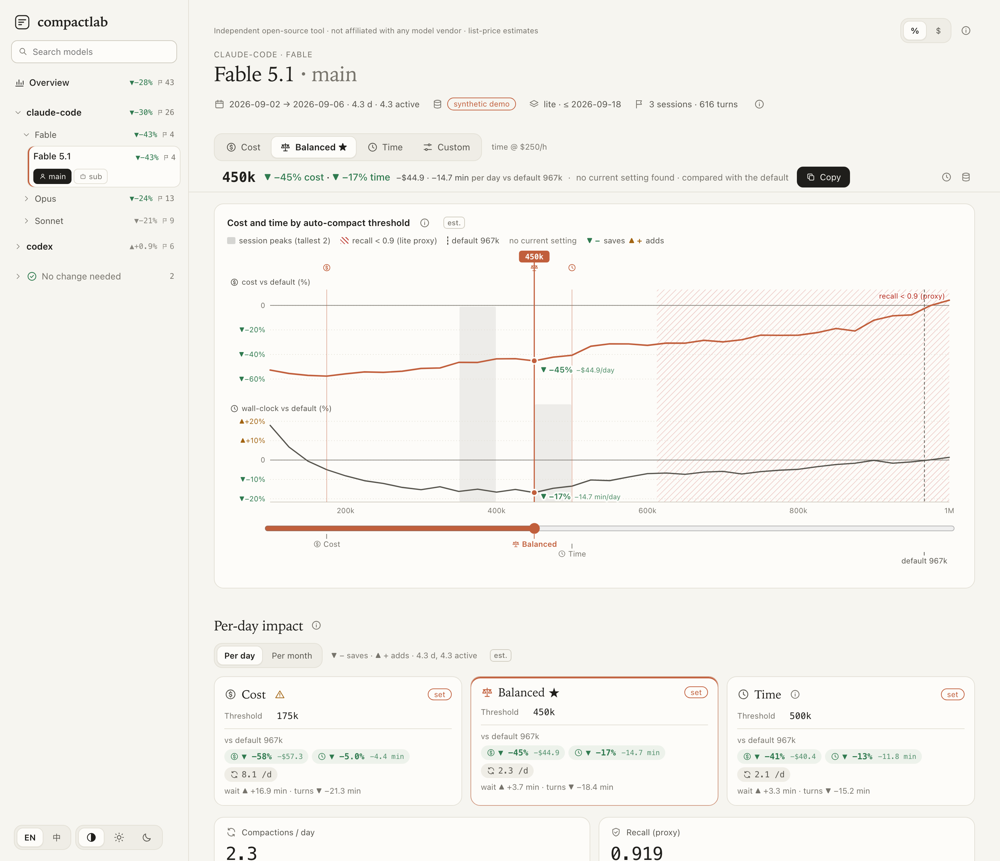
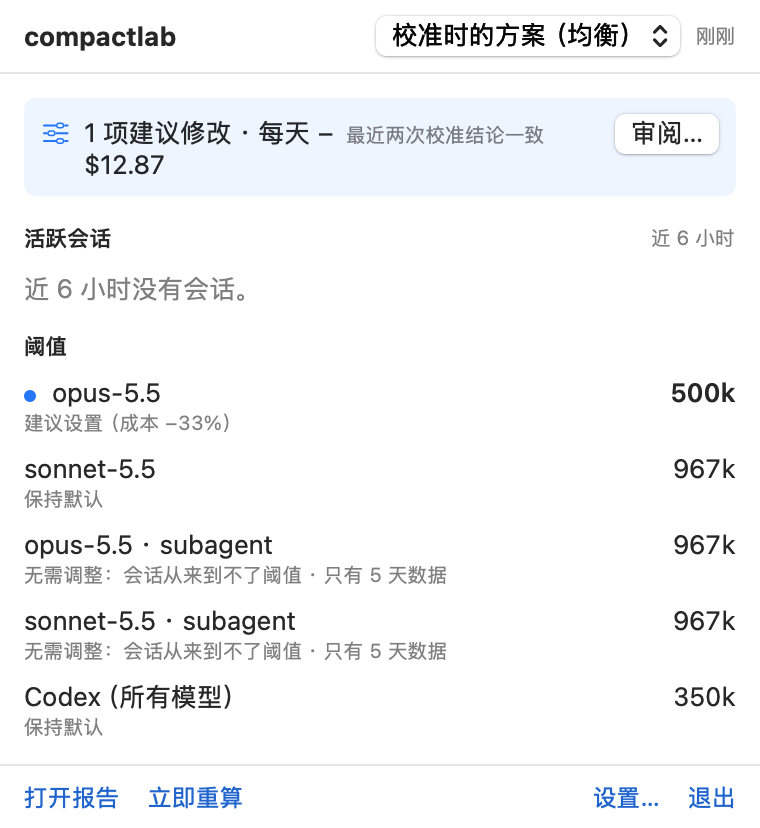
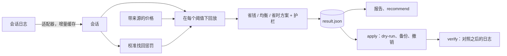

<div align="center">

# compactlab

compactlab 是一个命令行工具，用你自己的 Claude Code 和 Codex 会话日志算出自动压缩阈值该设多少。它在每个阈值下把你跑过的会话重放一遍，按模型和角色分别给出成本、等待时间和上下文损失之间的平衡点，再帮你写入设置、对照日志核对效果，不满意可以撤销。

[](https://github.com/LemonCANDY42/compactlab/actions/workflows/ci.yml)
[](https://github.com/LemonCANDY42/compactlab/releases)
[](https://github.com/LemonCANDY42/homebrew-tap)


[](LICENSE)

[English](README.md) · **简体中文**



</div>

## 为什么需要它

Claude Code 和 Codex 会在上下文涨到某个 token 阈值时压缩对话。阈值设低了，摘要、缓存重写和找回被摘要丢掉的信息都要反复花钱；设高了，每一轮都要重读一大段缓存前缀（缓存读取便宜，但不免费），上下文太长也更容易出错。合适的数字取决于你的会话怎么增长、用哪些模型、价格多少，默认值或经验数字很少正好合适。

- **用你自己的日志。** 按你真实跑过的会话逐轮回放，每个阈值都算一遍，不拿基准测试代替。
- **按模型、按角色分开算。** 主会话和子 agent 的上下文涨法不同，Opus、Sonnet 和 GPT 的会话也各不相同。
- **钱和时间一起算。** 三个方案（`cost` 省钱、`balanced` 均衡、`time` 省时）给一小时等待定了不同的价钱，再用护栏限制窗口最小能设多小、每天最多多等多久。
- **改完还能核对。** `apply` 写入设置前先备份，`verify` 过几天拿日志对照回放的预测，`revert` 撤销改动。
- **默认离线，不花钱。** lite 模式只在本机读日志，不调用任何模型。报告里只有 token 数和模型名，没有对话内容。



## 效果如何

目前有一个真实案例，来自维护者自己的机器（[详情](docs/RESULTS.md)，英文）。Claude Code 里 Opus 5.5 的主会话，阈值从默认的约 967k 手动改到 650k：

- **改之前，回放算出的成本和日志记录的成本相差不到 2%。** 这是对照组，说明回放足够准，后面的数字可以信。
- **改之后的 25 个活跃日里，每千轮的标价成本下降了 21%**（80% 区间 −24% 到 −17%；改前 125 个会话，改后 86 个）。
- **回放认为其中约三分之一到三分之二来自阈值。** 其余来自 Claude Code 的空闲压缩，这个功能正好在那几天出现在这台机器上；compactlab 现在能把两者分开计算。

一台机器、一种用法、按标价计算，算不上基准测试。`compactlab share` 会生成一份匿名记录，你可以自己贴出来，帮忙收集更多案例（[SHARING.md](docs/SHARING.md)）。

## 安装

```bash
brew install LemonCANDY42/tap/compactlab
```

也可以用 uv 或 pipx 安装：`uv tool install git+https://github.com/LemonCANDY42/compactlab`。compactlab 没有发布到 PyPI。需要 Python 3.11+，没有运行时依赖。在 macOS 上测试过，Linux 在 CI 里跑。

不安装也能先试一下（用内置的合成会话，不需要历史记录或 API key）：

```bash
uvx --from git+https://github.com/LemonCANDY42/compactlab compactlab demo
```

## 快速上手

```bash
compactlab doctor                     # 看它找到了哪些工具、日志和设置文件
compactlab report --open              # 分析最近 30 天，生成离线 HTML 报告
compactlab recommend --copy           # 给出每个工具要粘贴的设置（只打印或复制，不写文件）

compactlab simulate --out result.json # 同样的分析，存下来给 apply 用
compactlab apply --result result.json --claude-settings ~/.claude/settings.json   # 只显示 diff，不写入
compactlab verify                     # 几天后：核对改动是否和回放的预测一致
compactlab revert                     # 撤销最近一次 apply
```

每个模型和角色都有三个方案，和 harness 默认值、你当前的设置并排列出，附上每天成本、耗时和压缩次数的变化。有的分组用默认值就行，这时结果显示**无需调整**、**保持当前**或**保持默认**，不会硬给一个修改。

| 方案 | 一小时等待值多少钱 | 护栏 |
| --- | --- | --- |
| `cost` 省钱 | 10 美元 | 窗口低于 25%、或每天多等超过 30 分钟时警告 |
| `balanced` 均衡（默认） | 250 美元 | 不低于窗口的 40%；每天最多多等 30 分钟 |
| `time` 省时 | 600 美元 | 不低于窗口的 50%；每天最多多等 30 分钟 |

怎么读输出、它能给出的每个设置键、`verify` 的细节和各工具的说明，见[**使用指南**](docs/GUIDE.md)（英文）。

## 使用方式

| | 是什么 | 详见 |
| --- | --- | --- |
| **命令行和报告** | `simulate`、`report`、`recommend`、`apply`、`verify`。报告是一个离线 HTML 文件，中英文、浅色深色都有。 | [使用指南](docs/GUIDE.md) |
| **`compactlab top`** | 类似 htop 的终端视图：左边是模型，右边是所选模型的成本和耗时曲线。 | [TUI.md](docs/TUI.md) |
| **菜单栏应用**（macOS，预览） | 每个活跃会话离阈值还有多远、提示词缓存是否还热、每天自动校准，以及审阅 → 应用 → 核对 → 撤销。中英文界面。 | [app/](app/README.md) |
| **后台服务** | `compactlab serve` 按计划重新校准，在本机提供报告和 JSON 接口；可选开启自动应用，限制很严。 | [SERVICE.md](docs/SERVICE.md) |
| **会话内 lens** | 一个 Claude Code mod，在输入框上方加一行，显示本会话的上下文和默认阈值、compactlab 阈值的距离。 | [MOD.md](docs/MOD.md) |
| **引擎接口** | `compactlab engine`：在 stdout 输出带版本号的 JSON，给应用和脚本用，不开端口。 | [ENGINE_API.md](docs/ENGINE_API.md) |

<p align="center">
  
  
</p>

菜单栏应用需要先装好这个命令行工具，目前要从源码构建（`app/scripts/package_app.sh`）；签名的 Homebrew cask 还在计划中。lens mod 的安装命令是 `/plugin install compactlab-lens --marketplace LemonCANDY42/compactlab`；它是独立的开源项目，与 Anthropic 无关。

## 支持的工具

| 工具 | 读取 | 设置 | 状态 |
| --- | --- | --- | --- |
| Claude Code | `~/.claude/projects/**/*.jsonl`，含子 agent | `recommend` 和 `apply`：`modelSettings.<model>.autoCompactWindow` | 已支持 |
| Codex | `~/.codex/sessions/**/rollout-*.jsonl` | `recommend` 和 `apply`：`model_auto_compact_token_limit`（全局一个值） | 已支持 |
| OpenCode 1.x | `~/.local/share/opencode/opencode.db`（只读打开） | `recommend`：按模型的 `limit` | 已支持 |
| DeepSeek Harness (dsh) | `~/.dsh/sessions/**` | `recommend`：一条 `modelPolicies` | 实验性，还没在真实历史上跑过 |
| Gemini CLI | `~/.gemini/tmp/<project>/chats/*.jsonl` | `recommend`：`model.compressionThreshold` | 实验性，还没在真实历史上跑过 |

Hermes、Qwen Code、Kimi CLI 和 Goose 在[路线图](docs/ROADMAP.md)里；想自己加一个，见[适配器指南](docs/ADDING_A_HARNESS.md)。

## 原理



compactlab 把每个会话拆成每一轮新增的 token 数，再在每个阈值下重放这段增长。它计入缓存读取、缓存写入（按日志里记录的缓存档位计价）、输出、每次压缩的摘要调用，以及压缩后常见的重读和纠正；耗时按你自己的时间戳拟合出的延迟曲线累加。公式，以及哪些是实测、哪些是假设：[METHODOLOGY.md](docs/METHODOLOGY.md)。背景：[WHY_THRESHOLDS.md](docs/WHY_THRESHOLDS.md)。

## 隐私与安全

- **默认离线。** lite 模式不联网，也不调用模型。只有 `pricing refresh`（或手动开启的 `pricing auto`）会下载公开的价格文件；只有 deep 模式会调用模型，调用前先显示预估费用，并要求 `--yes` 和 `--budget`。
- **报告里没有对话内容。** 报告和 `result.json` 只有 token 数、模型名和会话 id，`report --redact` 会把 id 换成哈希。扫描缓存只存 token 数和时间，不存提示词、工具参数和输出（例外：最后一条还没收到回复的消息）。
- **写入要你同意，也能撤销。** `apply` 默认只显示 diff；写入需要 `--write` 加[预授权文件](docs/SAFETY.md)或 `--i-authorize`，每个文件都先备份，`revert` 只还原它改过的键。
- **分享是你自己贴出去的一个文件。** `compactlab share` 只写数字和模型名，不发送任何东西。

威胁模型和漏洞报告方式：[SECURITY.md](SECURITY.md)。

## 局限

- lite 模式的召回率是**假设曲线**，不是实测；deep 模式会抽样实测。
- 成本是按公开标价的估算，用来对比不同阈值，不等于你的账单（不考虑订阅、折扣和额度）。耗时来自日志时间戳，数据少时会标出来。
- 真实日志上的核对目前只有上面那一台机器，要推广到别的用法还需要更多案例。
- 没在 Windows 上测试过。

完整列表见[使用指南 § Limitations](docs/GUIDE.md#limitations)。

## 文档

文档除特别注明外都是英文。

- [使用指南](docs/GUIDE.md)：怎么读输出、设置键、apply 和 verify、各工具的说明
- [真实日志上的结果](docs/RESULTS.md) · [方法与局限](docs/METHODOLOGY.md) · [为什么阈值重要](docs/WHY_THRESHOLDS.md)
- [安全：apply 与 revert](docs/SAFETY.md) · [作为后台服务运行](docs/SERVICE.md) · [分享结果](docs/SHARING.md)
- [终端视图](docs/TUI.md) · [HTML 报告设计](docs/REPORT_UI.md) · [lens mod](docs/MOD.md) · [菜单栏应用](app/README.md) · [菜单栏应用设计与评估](docs/MENUBAR_APP.zh-CN.md)（中文）
- 贡献者：[架构](docs/ARCHITECTURE.md) · [引擎接口](docs/ENGINE_API.md) · [添加适配器](docs/ADDING_A_HARNESS.md) · [路线图](docs/ROADMAP.md)

全部文档的索引在 [docs/README.md](docs/README.md)。

## 相关项目

[ccusage](https://github.com/ryoppippi/ccusage) 和 [CodexBar](https://github.com/steipete/CodexBar) 也从这些日志统计 token 用量和成本；compactlab 参考了它们解析日志的做法，没有用它们的代码。Chroma 的 [Context Rot](https://trychroma.com/research/context-rot) 报告研究长上下文下模型表现怎样下降，LangWatch 的[最优上下文窗口研究](https://langwatch.ai/research/finding-the-optimal-context-window)在它自己的 agent 上考察了同一个取舍。

## 参与贡献

欢迎贡献适配器、价格更新和新的事实核查启发式；测试只用合成数据。见 [CONTRIBUTING.md](CONTRIBUTING.md)。

## 许可

[MIT](LICENSE)
