# compactlab

**你的 agent 历史记录会告诉你在哪里自动压缩。** 按模型、按角色(主会话 / 子 agent)衡量成本与长上下文衰减之间的取舍,再安全地调整 auto-compact 阈值。


```bash
uvx --from git+https://github.com/LemonCANDY42/compactlab compactlab demo   # 用内置合成数据生成报告并打开,不需要历史记录或 API key
```

安装(从 GitHub 安装,PyPI 上没有):`uv tool install git+https://github.com/LemonCANDY42/compactlab`(或 `pipx install git+https://github.com/LemonCANDY42/compactlab`),之后直接运行 `compactlab ...`。

## 它解决什么问题

Claude Code 和 Codex 会在上下文达到某个 token 阈值时压缩对话。阈值太低,要频繁付摘要、缓存重写和找回丢失信息的成本;阈值太高,每一轮都要重读巨大的缓存前缀,长上下文本身也会变得不可靠。合适的数字取决于你自己的会话怎么增长、用什么模型、价格多少。compactlab 用你自己的会话日志在每个阈值下回放一遍,告诉你平衡点在哪里。

## 三个方案

每个模型、每种角色并排给出三个**方案**。方案的区别在于给一小时 agent 耗时定多少钱,外加几条护栏:

| 方案 | 时间价值 | 护栏 |
| --- | --- | --- |
| `cost` 省钱 | 每小时 10 美元(钱优先) | 不限窗口下限;低于最大窗口 25%、或每天多等压缩超过 30 分钟时会警告 |
| `balanced` 均衡(默认) | 每小时 250 美元 | 不低于最大窗口的 40%;每天多等压缩不超过 30 分钟 |
| `time` 省时 | 每小时 600 美元(时间优先) | 不低于最大窗口的 50%;每天多等压缩不超过 30 分钟 |

在护栏范围内,每个方案选评分(按标价回放的成本 + 找回惩罚 + 时间价值 × 耗时)落在自身最低值 2% 以内的最大阈值,且假设召回率不低于下限(0.90)。`--profile` 决定 `apply`、`recommend` 和报告默认用哪一个,`--value-of-time` 可覆盖该方案的时间价值;两者都能直接作用于已保存的结果,不用重跑。

## 与默认设置对比

每个方案都会和 **harness 默认值**(什么都不改时的压缩点)对比,能读到配置时也和**你当前的设置**对比:成本差、耗时差(按小时和每天分钟数;更小上下文省下的时间减去压缩和找回增加的时间,用你自己的时间戳拟合)、每天压缩次数、召回率。默认设置在某组会话里从未触发压缩时显示"无需调整";方案不比默认更好时显示"保持默认"。

几点说明:成本是按公开标价的**估算**,不含折扣、套餐或额度;lite 模式的召回率是**代理值**,不是实测;某组可计时的压缩少于 20 次时,不用它自己的拟合,改用同工具全部会话的汇总拟合或偏保守的先验值,并会写明。命令行输出和 HTML 报告默认中英双语,`--lang zh|en` 可切换。

示例输出(**合成演示数据**,不是基准测试,`--lang zh`;`*` 表示当前选中的方案):

```
claude-opus-5-5 · main · 6 sessions · 1308 turns · 10 days · window 1000k
  方案                 阈值 建议                       成本差(对默认)     时间差(每天)       每天压缩             召回
  默认                 967k -                             $403 (base)                0            0.8            0.871
  当前                 600k -                            -$102 (-25%)        -1m (-0m)            1.4            0.909
  均衡*                500k 设置                         -$135 (-33%)      -0.1h (-1m)            1.7   0.916 (+0.045)
  省钱                 175k 设置                         -$233 (-58%)      -0.2h (-1m)            6.5   0.922 (+0.051)
  省时                 650k 设置                          -$88 (-22%)        -6m (-1m)            1.2   0.902 (+0.030)
  · 对当前: 省钱 -$131 (-43%) -0.2h; 均衡 -$32 (-11%) -0.1h; 省时 +$14 (+5%) -4m
  · 时间模型:每轮耗时来自本组数据,压缩耗时来自本组数据(本组 22 个样本)
  · 均衡:护栏把选择从 300k 调到 500k
  · 省钱:低于最大窗口的 25%,会频繁做有损压缩
  · 省时:护栏把选择从 325k 调到 650k
  · 默认依据:原生 1M 窗口的模型默认在约 967K token 时压缩;当前:modelSettings.claude-opus-5-5.autoCompactWindow in settings.json

claude-opus-5-5 · subagent · 3 sessions · 143 turns · 4 days · window 1000k
  方案                 阈值 建议                       成本差(对默认)     时间差(每天)       每天压缩             召回
  默认                 967k -                              $18 (base)                0            0.0            0.937
  当前                 600k -                               +$0 (+0%)        +0m (+0m)            0.0            0.937
  均衡*                   - 无需调整                                -                -            0.0            0.937
  省钱                    - 无需调整                                -                -            0.0            0.937
  省时                    - 无需调整                                -                -            0.0            0.937
  · 无需调整:默认设置在这些会话里从未触发压缩
  · 时间模型:每轮耗时来自全部 claude-code 会话(本组样本太少),压缩耗时来自全部 claude-code 会话(本组样本太少)(本组 0 个样本)
  · 默认依据:原生 1M 窗口的模型默认在约 967K token 时压缩;当前:modelSettings.claude-opus-5-5.autoCompactWindow in settings.json
```

## 每日影响

对每个分组的每个方案,分别和 harness 默认值、你当前的设置比较:每天省下或多花的钱(美元)、省下或多出的耗时(分钟,压缩等待和上下文变小带来的每轮提速分开列),以及压缩次数;每项都给出每个自然日、每个活跃日和每月(按 30 天)三种口径。自然日是历史实际覆盖的时间跨度,活跃日是至少有一轮对话的本地日期。按自然日平均会低估重度用户一天的影响,所以两种都列出。**符号:`-$204.8/天` 表示每天省 $204.8**,`+` 表示增加。报告里节省用绿色,多花的钱或时间用琥珀色,红色只留给护栏被突破的情况。金额按公开标价估算,召回率是 lite 模式的代理值。`compactlab recommend` 会在配置片段后面打印同一张表(`--json` 放在 `impact` 字段里):

```
Per-day impact · claude-opus-5-5 · main · history 10.5 calendar days, 10.5 active days (with ≥1 turn)
  vs harness default 967k
    profile         window      $/day  $/active d     $/month   min/day     wait    turns  min/active d   h/month  compact/d  /month
    balanced*         500k     -$12.9      -$12.9     -$386.1      -0.8     +2.0     -2.9          -0.8      -0.4        1.7      52
    cost              175k     -$22.3      -$22.3     -$668.0      -1.4     +7.8     -9.2          -1.4      -0.7        6.5     195
    time              650k      -$8.4       -$8.4     -$252.6      -0.6     +1.1     -1.7          -0.6      -0.3        1.2      37
  vs your current 600k
    profile         window      $/day  $/active d     $/month   min/day     wait    turns  min/active d   h/month  compact/d  /month
    balanced*         500k      -$3.1       -$3.1      -$93.1      -0.7     +0.1     -0.8          -0.7      -0.3        1.7      52
    cost              175k     -$12.5      -$12.5     -$375.0      -1.2     +5.9     -7.1          -1.2      -0.6        6.5     195
    time              650k      +$1.3       +$1.3      +$40.4      -0.4     -0.8     +0.4          -0.4      -0.2        1.2      37
```

(合成演示数据,`--lang en`。演示数据每天都有会话,所以活跃日等于自然日。)

HTML 报告是一个离线文件(不加载任何字体、脚本或图片),中文或英文(跟随浏览器语言,一键切换),浅色或深色(跟随系统,也可手动切换)。界面以图标、增减标签(▼ 绿色节省,▲ 琥珀色增加)和小进度条为主,说明文字收在 ⓘ 提示里,警告是带提示的 ⚠ 图标。左侧栏按工具 / 模型 / 角色列出分组(手机上变成顶部栏);页头写明历史的日期范围、数据来源和模式;置顶的控制栏有方案切换和阈值滑块;下面依次是指标卡、各方案的每日影响、对比表、帕累托前沿、成本和耗时曲线(悬停或点按有提示,曲线直接标注)、token 分布和单个会话的回放。数据少、历史短或时间模型借用了汇总数据时,会用直白的话说明。

## 作为后台服务运行

`compactlab serve --every 1d` 在本机(只绑定 127.0.0.1)提供实时报告和 JSON 接口,并按设定间隔用 lite 模式重新校准:只增量扫描,同一时间只跑一个,低优先级,不联网。`compactlab schedule print` 生成 launchd / systemd 定时文件,`install --yes` 只把文件写进你的 LaunchAgents 或 systemd 用户目录,加载由你自己执行。自动应用默认关闭:先用 `compactlab consent set` 指定允许修改的设置文件、模型和方案,再加 `--auto-apply`;它复用 `apply` 的备份和清单(`compactlab revert` 可撤销),每次最多移动 100k,至少间隔一周,收益不明显时不动,别人手动改过的值不覆盖。详见 [docs/SERVICE.md](docs/SERVICE.md)。

## 终端界面

在终端里,`demo`、`simulate`、`recommend`、`doctor` 和 `serve` 会画出紧凑视图(颜色、边框、阈值刻度、前后对比条);
通过管道或加 `--plain` 时输出完整的纯文本表格。`compactlab top` 是类似 htop 的实时视图:左边是模型,右边是所选模型的成本和耗时曲线。



```bash
compactlab top --demo     # 合成数据;按 ? 看帮助,p 切换方案,% 切换单位,c 复制,r 重新校准,q 退出
```

按键说明见 [docs/TUI.md](docs/TUI.md)。

## 会话内 lens(Claude Code mod)

`mods/compactlab-lens` 是一个可选的 Claude Code mod。它在输入框上方加一行,在桌面端加一个侧边面板,显示本会话的上下文和默认阈值、compactlab 阈值的位置,`simulate` 估算的每日节省,以及当前生效窗口和方案不一致时的 ⚠。它只读取 `simulate` 写出的 `~/.compactlab/lens.json`,不写设置、不调用模型、不联网;“复制”按钮会把 `/autocompact <n>` 放到剪贴板。安装:`/plugin install compactlab-lens --marketplace LemonCANDY42/compactlab`。详见 [docs/MOD.md](docs/MOD.md)。这是独立开源项目,与 Anthropic 无关。

## 两种模式

- **lite(默认)**:只用日志和价格表,离线、零成本:回放模拟、成本模型、找回惩罚、摘要事实核查启发式。
- **deep(需显式开启)**:在 lite 基础上,通过 Claude Code 或 Codex 调用你选的模型,在候选阈值处重新生成摘要,用真实事实做探针,并用另一个模型当评审。先显示预估费用,需要 `--yes`,`--budget` 是硬上限。两套结果并排展示,不一致的地方会标出来。

## 复制推荐设置

`compactlab recommend` 按工具和作用范围(`--scope global|project|agent`)、方案(`--profile cost|balanced|time`,默认均衡;`--all-profiles` 三个一起输出)和格式(`--format json|toml|yaml|env|shell`)生成可直接粘贴的配置,`--copy` 复制到剪贴板(macOS),`--check` 检查用到的配置键是否仍经过文档核实。每段配置都写明目标文件、不覆盖其他键的合并命令、依据(来自哪些分组、相对默认的差值、每天耗时变化、时间模型来源)和还原方法;数值不会超出模型窗口或你设的上限,无需调整的分组会单独列出。它只打印或复制,写文件仍然只能用 `apply`。HTML 报告里有同样的面板和复制按钮。Codex 的 agent/profile 层是否认这个键官方文档没写,会带警告输出;Codex 没有对应的环境变量,不会编造。

## 安全与隐私

- 默认完全离线,不联网、不调用模型。
- 报告和 `result.json` 只包含 token 数、模型名和会话 id,不包含对话内容和路径;`--redact` 可把 id 换成哈希。
- `apply` 默认只出 dry-run diff;写入需要 `--write` 加预授权文件(或 `--i-authorize`),写入前自动备份,`revert` 只还原改过的键。
- Claude Code 写 `modelSettings.<model>.autoCompactWindow`(按模型);Codex 写顶层 `model_auto_compact_token_limit`(全局,不能按模型区分)。

## 局限

- lite 模式的召回率是**假设曲线**,不是任何模型的实测数据;deep 模式测的是对 compactlab 摘录的抽样结果。
- 回放成本是按公开标价的估算,用于比较不同阈值,不等于你的账单(不考虑订阅、折扣和额度)。
- 内置价格是带日期的公开快照(models.dev),可用 `compactlab pricing refresh` 更新或用 `--pricing` 覆盖。
- dsh、opencode、pi 的适配器在计划中,欢迎贡献(见 `docs/ADDING_A_HARNESS.md`)。

MIT 许可。英文完整说明见 [README.md](README.md)。
