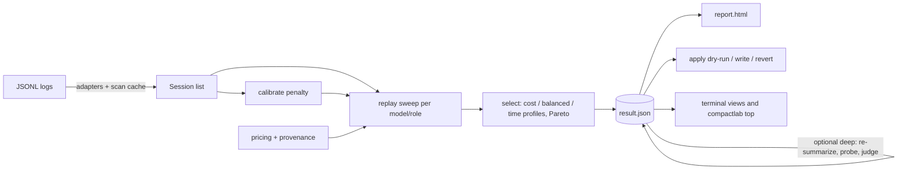

# Architecture

```
src/compactlab/
  adapters/   base.py (Adapter, Parser, registry) · claude_code.py · codex.py · cache.py (incremental scan cache)
  model/      Turn, Compaction, Session + (de)serialization
  pricing/    PricingTable with provenance (bundled -> refreshed -> user) · refresh.py (models.dev / LiteLLM)
  sim/        engine.py (traces, replay, sweep) · calibrate.py (re-discovery penalty) · select.py (profiles,
              guardrails, Pareto)
  eval/       factcheck.py (offline heuristics) · deep.py (probes, judge, budget, re-summarize) · executors.py
  report/     html.py + template.html (single offline file)
  recommend/  per-harness Recommender: ready-to-paste snippets (claude_code.py, codex.py); knobs in data/config_knobs.json
  apply/      pre-authorization, plan, diff, backup/manifest, key-level revert
  cli/        main.py (argparse commands)
  term/       style.py (colour depth, palette, display width) · widgets.py (gauge, was/now, sparkline, braille,
              panel, header) · views.py (demo / simulate / recommend / doctor / serve) · top.py (`compactlab top`)
  data/       pricing.json, harness_formats.json (each with source + date)
  synth.py    synthetic transcripts for tests and `demo`
```



`result.json` (schema 2) is the seam: the report and `apply` read nothing else, so a result can be reviewed,
shared (it contains no transcript text) and applied later.

## Boundaries

- Adapters know file formats only. They emit one `Turn` per billed request and count what they do not recognize.
- `sim` is pure: sessions + prices + options in, numbers out. No I/O.
- `eval.deep` performs model calls only through an `LLMClient`; `executors.py` is the only place that shells out
  to a harness CLI. `pricing.refresh` is the only place that fetches a URL.
- `apply` is the only code that writes outside `~/.compactlab` and the output paths you pass.

## Scan cache

`~/.compactlab/cache/scan-v4.sqlite3` (stdlib `sqlite3`, WAL), one row per log file: size, mtime_ns, SHA-1 of the
first 4 KiB, offset of the last complete line, parser version, and the parser state in two parts, the session and
the rest that only resuming needs (seen ids, pending tool calls).

- Unchanged → rebuild the session from the row, without reading the resume part.
- Appended with the same head → resume from the offset. A torn last line is never consumed.
- Otherwise → full parse; the row is replaced. Bumping a parser's `version` invalidates its rows.

A scan touches only the rows of the files it scans and streams each log line by line, so a run that finds a few
appended logs rewrites a few rows instead of the whole cache. Each row is its own transaction: two runs can share
the cache, and a write that cannot get the lock within 10 s is skipped (the file is parsed again next time), never
fatal. A corrupt database is deleted and rebuilt. After each scan, rows of files that no longer exist are deleted;
deleted and replaced rows are overwritten with zeros (`secure_delete`), so their excerpts do not linger in free pages.
The first scan with a new cache version deletes the files of older versions (`scan-v1.json` to `scan-v3.json`), and
`compactlab cache clear` deletes every version. The directory is 0700 and the files 0600; `--no-cache` neither
reads nor writes it.
