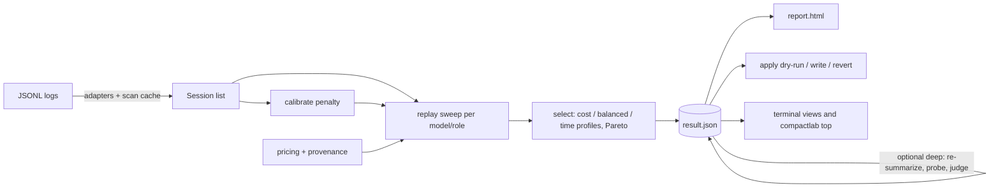

# Architecture

```
src/compactlab/
  adapters/   base.py (Adapter, Parser, registry) · claude_code.py · codex.py · cache.py (incremental scan cache)
  model/      Turn, Compaction, Session + (de)serialization
  pricing/    PricingTable with provenance (bundled -> refreshed -> user) · refresh.py (models.dev / LiteLLM)
  sim/        engine.py (traces, replay, sweep) · calibrate.py (re-discovery penalty) · select.py (profiles,
              guardrails, Pareto)
  eval/       factcheck.py (offline heuristics) · deep.py (probes, judge, budget, re-summarize) · executors.py
  report/     html.py + template.html (single offline file)
  recommend/  per-harness Recommender: ready-to-paste snippets (claude_code.py, codex.py); knobs in data/config_knobs.json
  apply/      pre-authorization, plan, diff, backup/manifest, key-level revert
  cli/        main.py (argparse commands)
  service/    core.py (calibrator) · lock.py (one calibration or config write at a time per state dir, across
              processes) · policy.py (auto-apply) · schedule.py · http.py (`serve`)
  engine/     the JSON contract for apps (`compactlab engine`) · live.py (active sessions from log tails) ·
              watch.py (JSON Lines loop)
  term/       style.py (colour depth, palette, display width) · widgets.py (gauge, was/now, sparkline, braille,
              panel, header) · views.py (demo / simulate / recommend / doctor / serve) · top.py (`compactlab top`)
  data/       pricing.json, harness_formats.json (each with source + date)
  synth.py    synthetic transcripts for tests and `demo`
```



`result.json` (schema 2) is the seam: the report and `apply` read nothing else, so a result can be reviewed,
shared (it contains no transcript text) and applied later.

## Boundaries

- Adapters know file formats only. They emit one `Turn` per billed request and count what they do not recognize.
- `sim` is pure: sessions + prices + options in, numbers out. No I/O.
- `eval.deep` performs model calls only through an `LLMClient`; `executors.py` is the only place that shells out
  to a harness CLI. `pricing.refresh` is the only place that fetches a URL.
- `apply` is the only code that writes outside `~/.compactlab` and the output paths you pass.

## Scan cache

`~/.compactlab/cache/scan-v4.sqlite3` (stdlib `sqlite3`, WAL), one row per log file: size, mtime_ns, SHA-1 of the
first 4 KiB, offset of the last complete line, parser version, and the parser state in two parts, the session and
the rest that only resuming needs (seen ids, pending tool calls).

- Unchanged → rebuild the session from the row, without reading the resume part.
- Appended with the same head → resume from the offset. A torn last line is never consumed.
- Otherwise → full parse; the row is replaced. Bumping a parser's `version` invalidates its rows.

A scan touches only the rows of the files it scans and streams each log line by line, so a run that finds a few
appended logs rewrites a few rows instead of the whole cache. Each row is its own transaction: two runs can share
the cache, and a write that cannot get the lock within 10 s is skipped (the file is parsed again next time), never
fatal. A corrupt database is deleted and rebuilt, and a row that does not fit its parser (damaged, or written by
other code) is a miss: the file is parsed again and the row replaced.

After each scan, rows of files that no longer exist are deleted in one transaction, and deleted and replaced rows
are overwritten with zeros (`secure_delete`). Those zeroed pages reach the database file through a checkpoint, which
the prune runs at once; while another run is reading a snapshot that still holds the rows, SQLite must keep them, so
they are erased when the last run using the cache closes it. A prune that could not delete (the database busy or
unwritable) or not yet erase says so on stderr (in the service log for a background run), and `cache info` counts
rows of deleted logs. The first scan with a new cache version deletes the files of older versions (`scan-v1.json` to
`scan-v3.json`) and never a newer version's (a newer compactlab may share the directory); `compactlab cache clear`
deletes every version. The directory is 0700 and the files 0600; `--no-cache` neither reads nor writes it.

### Reusing an analysis result

The same database keeps the last four lite analysis results (`results` table). Before reading any log, a lite run
with the cache computes two keys:

- **files**: every log `load_sessions` would read, in scan order, as `Adapter.fingerprint()` describes it: path,
  parser version, size, mtime_ns and SHA-1 of the first 4 KiB (OpenCode: the database and its write-ahead log as
  files, and the ids and update times of the sessions inside the window). A log that is appended, added, deleted or
  ages out of `--since-days` changes it. It is taken before the scan, so a log that grows during the run only makes
  the saved key stale.
- **inputs**: the effective price table (after an automatic refresh), the options as `analyze` gets them (with what
  was read from the harness settings), the configured thresholds, a hash of compactlab's own files (code and bundled
  data) and the local time rules (TZ, the zone file).

The inputs key needs the models and harness/model pairs of the sessions; they are saved with the result (no prompt
text), so a run whose files key matches rebuilds the inputs key and, when it matches too, returns the saved result
without decoding a session. "No file parsed" is not enough on its own: another command may have brought the scan
cache up to date after the result was saved, and only the files key says whether these are the logs it was made from.
A run that could not read a log saves nothing. Notes that depend on today (price changes in the last 30 days, the
auto-refresh flag) are added after, to a saved and a new result alike, and a full run's result goes through the same
JSON round trip, so a reused run's output is byte for byte a full run's. The calibrator still stamps its own time,
reason and duration and runs auto-apply as usual. Deep mode and `--no-cache` never reuse.
