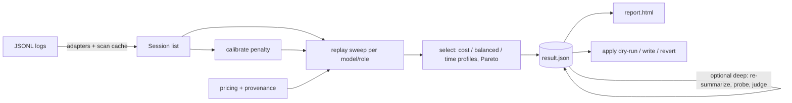

# Architecture

```
src/compactlab/
  adapters/   base.py (Adapter, Parser, registry) · claude_code.py · codex.py · cache.py (incremental scan cache)
  model/      Turn, Compaction, Session + (de)serialization
  pricing/    PricingTable with provenance (bundled -> refreshed -> user) · refresh.py (models.dev / LiteLLM)
  sim/        engine.py (traces, replay, sweep) · calibrate.py (re-discovery penalty) · select.py (profiles,
              guardrails, Pareto)
  eval/       factcheck.py (offline heuristics) · deep.py (probes, judge, budget, re-summarize) · executors.py
  report/     html.py + template.html (single offline file)
  recommend/  per-harness Recommender: ready-to-paste snippets (claude_code.py, codex.py); knobs in data/config_knobs.json
  apply/      pre-authorization, plan, diff, backup/manifest, key-level revert
  cli/        main.py (argparse commands)
  data/       pricing.json, harness_formats.json (each with source + date)
  synth.py    synthetic transcripts for tests and `demo`
```



`result.json` (schema 2) is the seam: the report and `apply` read nothing else, so a result can be reviewed,
shared (it contains no transcript text) and applied later.

## Boundaries

- Adapters know file formats only. They emit one `Turn` per billed request and count what they do not recognize.
- `sim` is pure: sessions + prices + options in, numbers out. No I/O.
- `eval.deep` performs model calls only through an `LLMClient`; `executors.py` is the only place that shells out
  to a harness CLI. `pricing.refresh` is the only place that fetches a URL.
- `apply` is the only code that writes outside `~/.compactlab` and the output paths you pass.

## Scan cache

Per file: size, mtime_ns, SHA-1 of the first 4 KiB, offset of the last complete line, parser state.
Unchanged → reuse; appended with the same head → resume from the offset (a torn last line is never consumed);
otherwise → full parse. Bumping a parser's `version` invalidates its entries.
