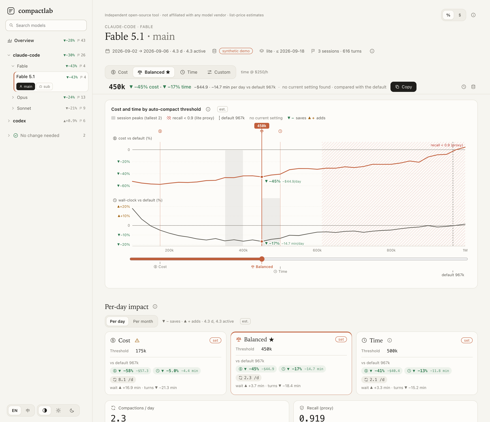
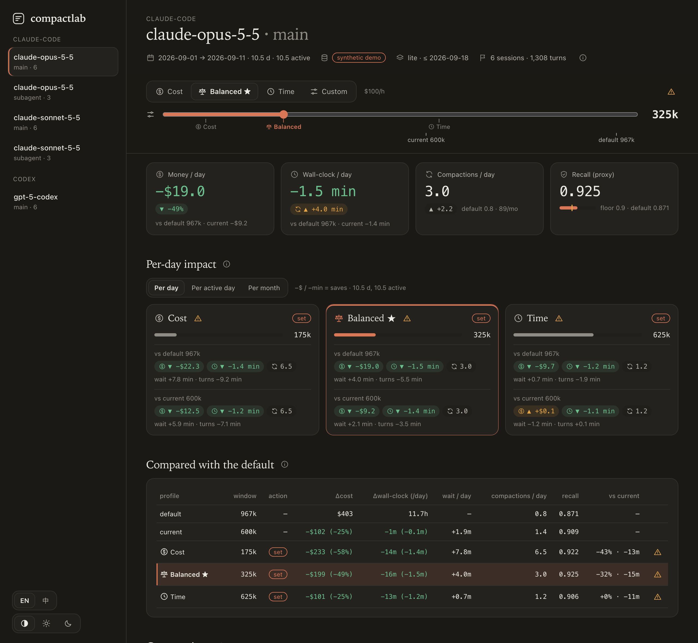
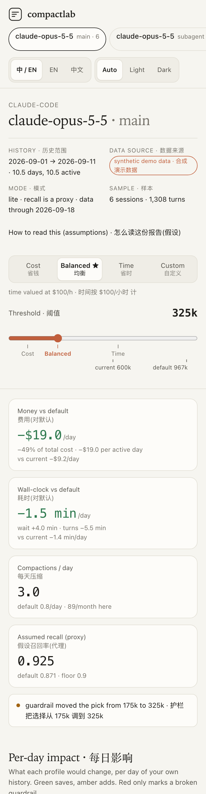

# User guide

How to read what compactlab prints, turn it into a setting, and check the setting afterwards. For the formulas
behind the numbers see [METHODOLOGY.md](METHODOLOGY.md); for what a write does and how to undo it,
[SAFETY.md](SAFETY.md).

- [Profiles](#profiles)
- [Reading the output](#reading-the-output)
- [Per-day impact](#per-day-impact)
- [Copy the settings](#copy-the-settings)
- [Apply, then check the prediction](#apply-then-check-the-prediction)
- [Idle compaction](#idle-compaction)
- [Lite and deep mode](#lite-and-deep-mode)
- [Harness notes](#harness-notes)
- [Limitations](#limitations)

## Profiles

For each model and role, compactlab gives three **profiles** side by side, each compared with **the harness default**
(what happens if you change nothing) and with **your current setting** when it can read it. A profile is the price
you put on an hour of agent wall-clock, plus guardrails:

| Profile | Value of time | Guardrails |
| --- | --- | --- |
| `cost` | $10/h (money first) | none on window size; warns below 25% of the max window and when compaction wait grows by more than 30 min/day |
| `balanced` (default) | $250/h | never below 40% of the max window; at most 30 min/day of added compaction wait |
| `time` | $600/h (time first) | never below 50% of the max window; at most 30 min/day of added compaction wait |

Within its guardrails, each profile picks the largest threshold whose score (list-price replay cost + re-discovery
penalty + value of time × wall-clock) is within 2% of its lowest, with assumed recall at or above a floor (0.90).
`--profile` chooses which one `apply`, `recommend` and the report lead with; `--value-of-time` overrides that
profile's price of time. Both work on a saved result without re-running.

Instead of a number you may see:

- **no action needed**: the default never compacts in those sessions.
- **keep current**: your setting scores within the same 2% of the profile's pick, so changing it would be churn.
- **keep default**: the profile would not beat the default by more than 2%.

Every profile reports Δcost, Δwall-clock in hours and minutes per day (time saved by smaller contexts minus time
added by compactions and re-discovery, fitted from your own timestamps), compactions per day and recall against the
default and your current setting. Costs are list-price estimates (no discounts, plans or credits). Recall in lite mode
is an assumed proxy, not a measurement. When a group has too few timed compactions (fewer than 20) its latency fit is
not used: it borrows the pooled fit of all sessions of that harness, or a deliberately pessimistic prior, and says so.

Why these defaults: with time priced near zero, real histories favour very small windows and several times the
default's compactions, each costing minutes of waiting and some lost detail. The `balanced` profile prices an hour of
your attention at $250 and never goes below 40% of the window; `--profile cost` is there if money is what you want to
minimize. Details: [METHODOLOGY.md § Profiles and guardrails](METHODOLOGY.md#profiles-and-guardrails).

## Reading the output

Sample output (**synthetic demo data**, not a benchmark; output is bilingual by default, `--lang en` shown; `*` marks
the selected profile):

```
claude-opus-5-5 · main · 6 sessions · 1308 turns · 10 days · window 1000k
  profile            window action                   Δcost vs default     Δtime (/day)  compactions/d           recall
  default              967k -                             $403 (base)                0            0.8            0.871
  current              600k -                            -$102 (-25%)        -1m (-0m)            1.4            0.909
  balanced*            500k set                          -$135 (-33%)      -0.1h (-1m)            1.7   0.916 (+0.045)
  cost                 175k set                          -$233 (-58%)      -0.2h (-1m)            6.5   0.922 (+0.051)
  time                 650k set                           -$88 (-22%)        -6m (-1m)            1.2   0.902 (+0.030)
  · vs current: cost -$131 (-43%) -0.2h; balanced -$32 (-11%) -0.1h; time +$14 (+5%) -4m
  · time model: turn latency from this group's data, compaction latency from this group's data (22 own samples)
  · balanced: guardrail moved the pick from 300k to 500k
  · cost: below 25% of the max window; expect frequent lossy compactions
  · time: guardrail moved the pick from 325k to 650k
  · default: models with a native 1M window compact at about 967K tokens by default; current: modelSettings.claude-opus-5-5.autoCompactWindow in settings.json

claude-opus-5-5 · subagent · 3 sessions · 143 turns · 4 days · window 1000k
  profile            window action                   Δcost vs default     Δtime (/day)  compactions/d           recall
  default              967k -                              $18 (base)                0            0.0            0.937
  current              600k -                               +$0 (+0%)        +0m (+0m)            0.0            0.937
  balanced*               - no action needed                        -                -            0.0            0.937
  cost                    - no action needed                        -                -            0.0            0.937
  time                    - no action needed                        -                -            0.0            0.937
  · no action needed: the default never compacts in these sessions
  · time model: turn latency from all claude-code sessions (this group is thin), compaction latency from all claude-code sessions (this group is thin) (0 own samples)
  · default: models with a native 1M window compact at about 967K tokens by default; current: modelSettings.claude-opus-5-5.autoCompactWindow in settings.json
```

The HTML report (`compactlab report --open`) is one offline file (no fonts, scripts or images fetched), in English or
Chinese (follows the browser language; one toggle switches), light or dark. A sidebar lists each harness / model /
role group; a sticky bar holds the profile switch and a threshold slider with marks for each profile, the default and
your current setting. Below it: KPI cards, the per-day impact of every profile, a comparison table, a Pareto
frontier, cost and wall-clock curves, where your tokens sit by context size, and any session's real context curve
next to the same session replayed at the chosen threshold. Thin data, short histories and borrowed time models are
called out in plain language. Layout and design choices: [REPORT_UI.md](REPORT_UI.md).

| Light | Dark | Phone |
| --- | --- | --- |
|  |  |  |

## Per-day impact

For each profile of each group, versus the harness default and versus your current setting: money saved or added
(USD), wall-clock saved or added (minutes, with compaction wait and the turn-speed gain from a smaller context shown
separately), and compactions, each per calendar day, per active day and per month (30 days). The calendar span is
the history window actually covered; an active day is a local date with at least one turn. Dividing by calendar days
understates a heavy user's day, so both are shown. **Sign: `-$204.8/day` means it saves $204.8 a day**; `+` adds.
The report colours savings green and added cost or time amber, and keeps red for broken guardrails.
`compactlab recommend` prints the same table after the snippets (`--json` adds it under `impact`):

```
Per-day impact · claude-opus-5-5 · main · history 10.5 calendar days, 10.5 active days (with ≥1 turn)
  vs harness default 967k
    profile         window      $/day  $/active d     $/month   min/day     wait    turns  min/active d   h/month  compact/d  /month
    balanced*         500k     -$12.9      -$12.9     -$386.1      -0.8     +2.0     -2.9          -0.8      -0.4        1.7      52
    cost              175k     -$22.3      -$22.3     -$668.0      -1.4     +7.8     -9.2          -1.4      -0.7        6.5     195
    time              650k      -$8.4       -$8.4     -$252.6      -0.6     +1.1     -1.7          -0.6      -0.3        1.2      37
  vs your current 600k
    profile         window      $/day  $/active d     $/month   min/day     wait    turns  min/active d   h/month  compact/d  /month
    balanced*         500k      -$3.1       -$3.1      -$93.1      -0.7     +0.1     -0.8          -0.7      -0.3        1.7      52
    cost              175k     -$12.5      -$12.5     -$375.0      -1.2     +5.9     -7.1          -1.2      -0.6        6.5     195
    time              650k      +$1.3       +$1.3      +$40.4      -0.4     -0.8     +0.4          -0.4      -0.2        1.2      37
```

(Synthetic demo data, `--lang en`. The demo spreads sessions over every day, so active days equal calendar days.)

## Copy the settings

```bash
compactlab recommend                                  # Claude Code settings.json fragment + Codex config.toml line
compactlab recommend --scope project --copy           # project-level, onto the clipboard (macOS)
compactlab recommend --scope agent                    # subagent frontmatter (autoCompactWindow)
compactlab recommend --format env                     # CLAUDE_CODE_AUTO_COMPACT_WINDOW instead
compactlab recommend --check                          # are the keys still verified against the docs?
```

Each snippet names its target file and carries a merge one-liner that leaves other keys alone, the evidence it came
from (groups, delta vs default, time per day, where the time model came from) and a revert hint. `--profile` picks the
profile (default balanced); `--all-profiles` prints all three. Values never exceed the model's window or your
caps, and groups that need no change are listed as omitted. `recommend` only prints or copies; `apply` is the only
command that writes, under pre-authorization. The report has the same panel with copy buttons.

| Harness | Scope | Key | Status |
| --- | --- | --- | --- |
| Claude Code | global / project | `modelSettings.<model>.autoCompactWindow` (v2.1.288+) | documented |
| Claude Code | agent | subagent frontmatter `autoCompactWindow` (v2.1.296+, lowers only) | documented |
| Claude Code | session | `CLAUDE_CODE_AUTO_COMPACT_WINDOW` env (wins over all), `--autocompact` flag | documented |
| Codex | global / project | top-level `model_auto_compact_token_limit` (project needs trust) | documented |
| Codex | session | `codex -c model_auto_compact_token_limit=N` | documented |
| Codex | agent / profile | role `config_file` layer, profile file | **unverified**: emitted with a warning |
| Codex | env var | none documented | not emitted |
| OpenCode 1.x | global / project | per-model `provider.<id>.models.<model>.limit` (`input` = threshold + 20,000) | public source; the note gives the 2.x `compaction.buffer` share |
| Gemini CLI | global / project | `model.compressionThreshold` (fraction of the token limit, one value for every model) | documented; adapter experimental |

Facts, sources and verified-on dates live in [`data/config_knobs.json`](../src/compactlab/data/config_knobs.json).

## Apply, then check the prediction

```bash
compactlab simulate --out result.json
compactlab apply --result result.json --claude-settings ~/.claude/settings.json            # dry-run diff
compactlab apply --result result.json --claude-settings ~/.claude/settings.json --write --i-authorize
compactlab verify                                                                          # days later
compactlab revert                                                                          # undo the last apply
```

`apply` prints a diff and writes nothing unless you pass `--write` with a pre-authorization file or `--i-authorize`;
every write is backed up and `revert` restores only the keys it changed. See [SAFETY.md](SAFETY.md).

`compactlab verify` splits your logs at the time of the last `apply` and compares, per model and role, the logged cost
and compactions per 1k turns before and after with what a replay of the *before* sessions predicted (plus a replay
of the *after* sessions, to show when the workload changed). Cost includes an estimate of each compaction's summary
request, which the logs do not record; threshold, idle and hand-typed compactions are counted apart, and a role whose
threshold was never reached gets no verdict on it. It also checks that compactions really happen near the
new threshold, which catches a setting that a project file, env var or CLI flag overrides. It says "too early" until
each side has 3 sessions and 2 active days. Cost is the list-price figure, not your invoice, and wall-clock is not
verified. Use `--id` for an older apply.

For a threshold you set by hand, describe it instead:
`compactlab verify --applied-at 2026-10-29T21:05 --model claude-opus-5-5 --new 625k [--old 967k]` (the time and old
value are yours; it says so when sessions before that time already compacted near the new threshold, i.e. you gave a
too-late date). For OpenCode add `--harness opencode` and name the model as `provider/model`; for Gemini CLI add
`--harness gemini-cli`, name the model, and give `--new` in tokens for it (the fraction times that model's token
limit; one fraction is a different token count on each window).

One checked case on real logs, with the control that makes the replay trustworthy: [RESULTS.md](RESULTS.md).

## Idle compaction

Claude Code also compacts on its own when you leave a long conversation idle on the one-hour cache (`idleCompaction`,
on by default, from 200k tokens): it makes the summary while the cache is still warm, about 55 minutes in, and
applies it when you return. compactlab tells these compactions apart in the logs, replays them (the summary's read
and output, the smaller context you return to, the re-discovery after it, and summaries made for sessions you never
resumed), and replays the groups it applies to with the setting flipped. After the groups it says whether to keep it
on, with the cost, wall-clock and compaction change per day; `recommend` prints an `idleCompaction` snippet only when
flipping it beats the current state by more than 2%.

## Lite and deep mode

| | `lite` (default) | `deep` (opt-in) |
| --- | --- | --- |
| Inputs | your logs + price table | lite + a model you choose, via Claude Code or Codex |
| Does | replay simulation, cost model, re-discovery penalty, summary fact-check heuristics | re-summarizes sampled sessions at candidate thresholds, probes them for ground-truth facts, LLM judge on a different model |
| Recall | assumed proxy | measured on samples; disagreements with lite are shown |
| Cost | $0, offline | shows an estimate first, needs `--yes`, stops at `--budget` (checked before each call and against measured spend after it; one call can overshoot the cap) |

```bash
compactlab simulate --mode deep --executor claude-code --model claude-sonnet-5-5 \
  --judge-model claude-haiku-5-5 --budget 3            # prints the estimate; add --yes to run
```

If measured recall at a profile's threshold falls below the floor, deep lowers that profile and says so.

## Harness notes

None of the supported harnesses lets subagents have their own threshold, so `apply` writes the main-role value.

- **Codex** has one top-level key, so `apply` writes one value chosen across the models in use (models superseded by
  a newer one, such as 6.1-sol, are left out).
- **DeepSeek Harness (dsh)** reads its threshold as a fraction of the window (default: the lower of 80% and window −
  256k output reserve − 65,536, about 727k on DeepSeek's 1M models). `recommend` prints a `modelPolicies` entry
  (`thresholdRatio`) for the compaction-basic plugin; where its plugin config lives is not verified, so `apply`
  leaves it alone. `.jsonl.zstd` logs need Python 3.14+ or the `zstd` command.
- **OpenCode 1.x** has no threshold key. It compacts at the window minus the model's output reserve (at most
  32,000), or at `limit.input − compaction.reserved` for a model whose `limit` sets `input`, so
  `compaction.reserved` alone does nothing for most models; `recommend` sets a per-model `limit` with `input` =
  threshold + 20,000 and gives the 2.x `compaction.buffer` share in a note. A custom model without a `limit` has no
  known window, and OpenCode never compacts it by itself. The database is opened read-only; 2.x pre-release storage
  is not read (`doctor` counts it).
- **Gemini CLI** compresses at `model.compressionThreshold` × the model's token limit (0.5 × 1,048,576 by default);
  the key is global, so one fraction serves every model and the snippet says where it lands for the others.
  Fractions are rounded so the trigger never lands above the pick, with a note when the window makes the step coarse.

`apply` writes neither OpenCode's nor Gemini CLI's config until their config locations and precedence are checked on
real setups. Defaults and their sources: [`data/harness_defaults.json`](../src/compactlab/data/harness_defaults.json).
To add a harness: [ADDING_A_HARNESS.md](ADDING_A_HARNESS.md).

## Limitations

- Lite-mode recall is an **assumed** curve, not a measurement of any model. Deep mode measures recall on samples
  of compactlab's excerpts, not the full transcript the harness would summarize.
- Replayed cost is a list-price estimate for comparing thresholds, not a reconstruction of your invoice
  (subscriptions, discounts and credits are ignored). Wall-clock estimates come from log timestamps (response time
  minus the preceding input), a proxy that is flagged when data is thin.
- The bundled prices are a dated public snapshot (models.dev). `compactlab pricing show` lists the source of every
  row; refresh or override them as needed. A model is priced from its own row when there is one, with platform IDs
  (Bedrock `us.anthropic.…`, Vertex `…@date`, OpenRouter `anthropic/…`, Azure, Codex's `model_provider`) mapped to
  that platform's price after a refresh and to the vendor's list price before. A model the table does not know borrows
  the closest model of its family (`claude-fable-5-3` from `claude-fable-5-2`), and anything else gets the fallback
  row; `simulate` lists both, and `pricing show --model <id> [--platform <p>]` shows how one is matched.
- Claude Code sizes the window from the model ID: a third-party model behind `ANTHROPIC_BASE_URL` (DeepSeek, Kimi,
  GLM, ...) is replayed with the 200K window Claude Code assumes for it, or `CLAUDE_CODE_MAX_CONTEXT_TOKENS` when set.
- Things change over time, and the replay follows the latest: history is priced at today's prices (a refresh older
  than the bundled snapshot no longer overrides it, and a saved result made before a price change says so when
  loaded); Codex's window is the one its latest sessions logged (a clean switch is reported); a Claude Code context
  larger than the assumed window means the window grew; and when your latest threshold compactions land more than
  10% from the assumed default, `simulate` says the harness default may have changed or a setting it cannot read is
  in force.
- Some log-format details (Codex fork replay, compaction events) are marked `assumed` in
  [`data/harness_formats.json`](../src/compactlab/data/harness_formats.json) until checked against more real files.
- Tested on macOS; Linux paths follow the same defaults and run in CI. Windows is untested.

More on what is measured and what is assumed: [METHODOLOGY.md § Known limits](METHODOLOGY.md#known-limits).
